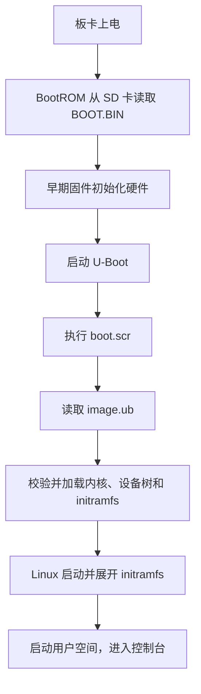
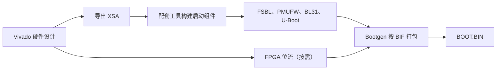
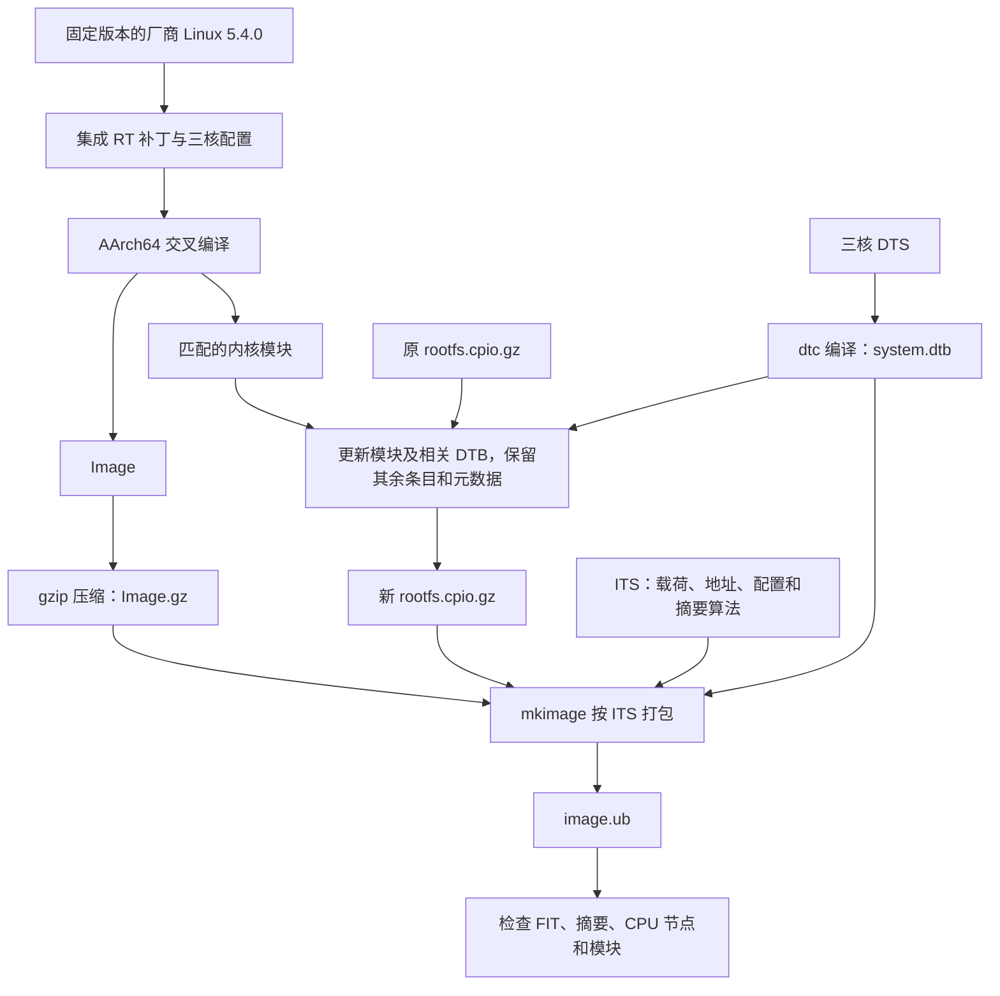
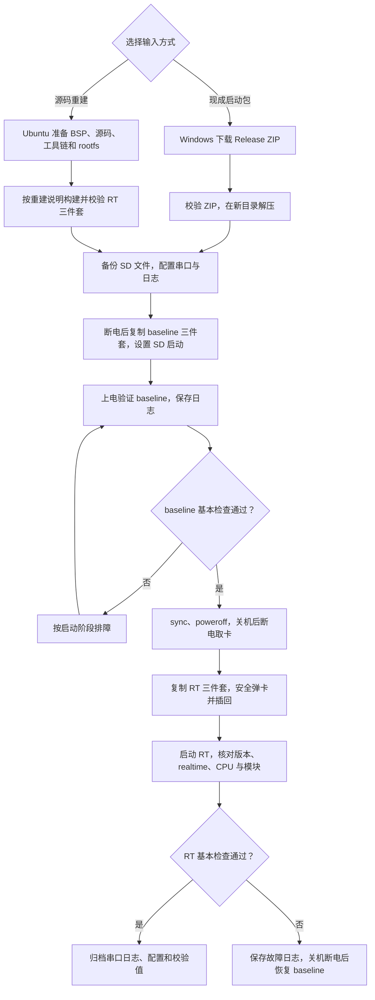

# P5 Linux 5.4.0 PREEMPT_RT 构建与上板验证

截至 2026-10-27，baseline 和 PREEMPT_RT 内核均已在正点原子 **P5（XCZU4EV）实板**上从 SD 卡启动。baseline 四核在线；RT 使用 A53 Core0／1／2，完整 RT 状态、基本命令、临时文件读写和已加载模块检查通过。实时延迟、长时间稳定性、完整外设功能及 Core3 裸机共存尚未验收。

本次部署使用的板卡是 P5，未使用另一块 P5B 实板做对照。BSP／XSA、设备树及启动包沿用 P5B 工程名称，日志中的 P5B 来自软件配置。资料检索中未发现 P5 与 P5B 在本次 Linux 部署所涉及配置上的明显差异；正点原子[官方资料中心](https://www.openedv.com/docs/build/html/index.html)也将两者合并列为“MPSoC - P5 / P5B开发板”。这属于现有资料范围内的结论，未逐项比对两版原理图和 BOM，不能据此认定所有硬件版本完全一致。检索依据及范围见[板型说明](docs/board/p5-and-p5b-scope.md)。仓库、路径和内核版本中的 p5b 保留原名，便于追溯。

## 阅读顺序

- 启动原理：[启动文件说明](#启动三件套作用生成方式与教程的对应关系)。
- 首次上板：[部署与验证流程](#部署与验证流程)、[下载与校验](#复现入口与所需文件)、[串口设置](#串口与-sd-启动设置)。
- 验收记录：[baseline](#baseline-部署与验证)、[RT](#rt-部署与验证)。
- 自行编译：[源码重建说明](docs/build/REPRODUCE.md)。


## 当前状态

| 检查项 | baseline | RT |
| --- | --- | --- |
| 内核 | `5.4.0-xilinx-v2020.2` | `5.4.0-rt1-xilinx-v2020.2-p5b` |
| SD 启动 | 通过，U-Boot 加载 FIT | 通过，内核／DTB／initramfs 哈希通过 |
| CPU | online 为 0-3 | possible／present／online 均为 0-2，硬件核心标识 0、1、2 |
| 完整 RT | 未按 RT 验收 | CONFIG_PREEMPT_RT=y、realtime=1 |
| 根目录 | 内存 rootfs，参数带旧 root= | 内存 rootfs，使用 rdinit=/init |
| 临时文件读写 | 通过 | 通过 |
| 模块 | 未逐个功能验收 | 构建 62 个；实测加载 dmaproxy、xlnx_vcu_core，未见版本／符号错误 |
| 外设 | 视频、时钟、VCU、无线数据库、SPI NOR 等问题；eMMC FAT 警告 | 相同问题仍在，新增 /dev/root 提示 |
| 实时延迟、AMP | 未测试 | 未测试 |

详细结果见 [baseline 记录](docs/board/baseline-first-boot-20261027.md)和 [RT 记录及问题对照](docs/board/rt-first-boot-20261027.md)。[原始串口日志及 SHA-256](logs/board/2026-10-27/)保留终端命令和输出。

## 启动三件套：作用、生成方式与教程的对应关系

本工程使用 `BOOT.BIN + boot.scr + image.ub`，三个文件位于 SD 卡 FAT32 启动分区根目录：

```text
SD 启动分区
├── BOOT.BIN
├── boot.scr
└── image.ub
```



### BOOT.BIN：早期初始化与引导

BOOT.BIN 是启动镜像。本工程沿用原工程的启动固件和 PL 位流。ZynqMP 的此类镜像通常组合 FSBL、PMU 固件、ARM Trusted Firmware（如 bl31.elf）、U-Boot，并可包含 FPGA 位流；具体成员及顺序以原工程的打包清单为准。

- FSBL 是第一阶段引导程序，负责 DDR 等早期硬件初始化和后续载荷装载。
- PMU 固件与 ARM Trusted Firmware 提供平台管理和底层运行服务。
- U-Boot 读取启动介质、运行脚本并引导 Linux。
- FPGA 位流配置 PL 中的硬件逻辑；它与 Linux 软件驱动的作用不同。

BOOT.BIN 的生成依赖匹配的硬件描述、启动固件、U-Boot 和打包配置：



PetaLinux 的 `petalinux-package --boot ...` 可组织打包。[AMD 2020.2 打包说明](https://docs.amd.com/r/2020.2-English/ug1144-petalinux-tools-reference-guide/Generate-Boot-Image)

本工程 RT 构建没有重新生成 BOOT.BIN，而是从原 ALIENTEK-MP 工程的 `images/linux/BOOT.BIN` 原样复制。仅修改 RT 内核时不需要重做这些早期组件；更换 XSA、DDR 配置、PL 设计或启动固件时，需要重新核对它们的匹配关系。仓库不含完整 BSP，不能只凭仓库从零生成同一 BOOT.BIN。

### boot.scr：交给 U-Boot 执行的启动脚本

脚本规定从哪个介质和分区加载文件、读到哪个内存地址、执行什么启动命令。执行它时 Linux 尚未启动，不能用 Linux Bash 去运行它。

boot.scr 由 U-Boot 脚本文本经 mkimage 封装生成：


以下为通用命令示例。已发布 RT 包复用原工程的 boot.scr，无需为本流程重新生成：

```sh
# 说明命令：需要匹配的原脚本文本，不用于直接替换当前启动文件
mkimage -C none -A arm64 -T script -d boot.cmd.default boot.scr
```

已发布 RT 包同样原样复用了原工程的 boot.scr。其 SD 启动分支优先寻找 image.ub，读取到 `0x10000000` 后执行 `bootm`；找不到时才尝试散放的 Image 和 system.dtb。原脚本文本保存在 Release ZIP 的 `evidence/boot-script.txt`。采用 FIT 启动时，更新内核需要重新打包 image.ub；单独替换 SD 上的 Image 不会更新 FIT 内的载荷。

### image.ub：内核、设备树和根文件系统的组合镜像

本工程 image.ub 使用 FIT（Flattened Image Tree）格式，实际包含：

```text
image.ub
├── Image.gz          RT Linux 内核
├── system.dtb        仅保留 Core0／1／2 的 Linux 设备树
└── rootfs.cpio.gz    initramfs，含命令、库、启动脚本和匹配模块
```

设备树描述 Linux 可用的硬件；它不代替驱动，也不配置 FPGA 逻辑。initramfs 是启动时展开到内存的初始根文件系统，本工程以它作为运行根目录，因此在其中临时修改文件，重启后会丢失。要保留修改，需要更新根文件系统并重新打包，或另行设计持久化存储。

image.ub 还包含载荷选择、加载地址和 SHA-256 摘要。摘要用于发现数据不一致，不等同于对镜像来源做签名认证。[U-Boot FIT 说明](https://github.com/u-boot/u-boot/blob/main/doc/usage/fit/howto.rst)

RT image.ub 的构建流程：



在[源码重建说明](docs/build/REPRODUCE.md)中，全部前置步骤完成后，最终打包命令为：

```bash
# Ubuntu Bash；ROOT 是重建说明中已建立的工作目录
mkimage -f "$ROOT/build/fit/p5b-rt.its" "$ROOT/deploy/rt/image.ub"
dumpimage -l "$ROOT/deploy/rt/image.ub"
python3 "$ROOT/scripts/validate-fit.py"
```

ITS 模板见 [configs/p5b-rt.its](configs/p5b-rt.its)，实际打包脚本见 [step6-package.sh](work/scripts/step6-package.sh)。模板中的 incbin 路径按重建目录布局解析，不能只复制 ITS 到任意目录后直接执行。原脚本包含本机路径和阶段完成标记，跨机器重建应按重建说明调整。

### 与教程中分开放置文件的方式有什么区别

PetaLinux 2020.2 的官方 SD 文件准备说明也使用 image.ub 和 boot.scr。[官方说明](https://docs.amd.com/r/2020.2-English/ug1144-petalinux-tools-reference-guide/Copying-Image-Files) 教程不同章节可能使用 FIT、分离内存根文件系统或 EXT4 根分区，需连同该节启动脚本和启动参数一起判断。

| 内容 | 分离文件／EXT4 方式 | 本工程 FIT + initramfs 方式 |
| --- | --- | --- |
| 早期固件及 U-Boot | BOOT.BIN | BOOT.BIN |
| 启动命令 | boot.scr 或手动输入 U-Boot 命令 | boot.scr |
| Linux 内核 | 独立 Image | 位于 image.ub 内 |
| Linux 设备树 | 独立 system.dtb | 位于 image.ub 内 |
| 根文件系统 | 独立 ramdisk，或已部署的 EXT4 分区 | 位于 image.ub 内，启动后在内存运行 |

image.ub 并非固定必须包含根文件系统；上表只描述本工程 FIT 配置。部署所用内核、设备树、模块与启动固件需要匹配。首次复现使用 Release 中同一套三件套。

## 部署与验证流程

### 选择现成包部署还是源码重建

| 目标 | 从哪里开始 | 额外条件 |
| --- | --- | --- |
| 复现已记录的 baseline／RT 启动结果 | 下方“复现入口与所需文件”，下载 Release 启动 ZIP | 匹配实板、Windows、串口工具、SD 卡和读卡器；无需先安装交叉工具链 |
| 自行生成 RT image.ub | [源码重建说明](docs/build/REPRODUCE.md)，按章节顺序执行 | Ubuntu 18.04、原 2020.2 工程／XSA／rootfs、固定厂商源码、配套工具链及 sysroot |
| 加入 ble.sh 自动加载 | 先完成原 RT 启动，再看[自动加载镜像说明](docs/board/bash-blesh-autostart-20261028.md) | 原 RT Release 不含此功能；自动加载包尚未发布为 Release，且新镜像尚未上板验收 |

GitHub 的“Code → Download ZIP”或“Source code”下载的是仓库资料，不是包含三件套的部署包；启动包需下载 Release 中名为 `p5b-rt-sd-20261027.zip` 的附件。

### 执行环境与检查点



源码重建分支同样要求目标板已有通过基本检查的 baseline。各阶段的操作位置和验收条件如下：

| 阶段 | 执行位置 | 操作与检查点 |
| --- | --- | --- |
| 下载与解压 | Windows PowerShell | 下载 Release 部署 ZIP，核对 SHA-256，在不存在的新目录解压 |
| SD 准备 | Windows 主机；板卡断电 | 使用已有 FAT32 启动分区，核对盘符并备份原文件；将对应目录内三个文件直接放到启动分区根目录 |
| 串口设置 | Windows MobaXterm | PS UART，115200、8N1、无流控；开启日志。串口设备保留给 Windows，Ubuntu SSH 会话用于主机构建 |
| baseline 验证 | 开发板 Linux 串口 | 执行“baseline 部署与验证”的命令；预期版本 5.4.0-xilinx-v2020.2、CPU online 0-3 |
| RT 切换 | 开发板关机后，在 Windows 读卡器中操作 | 板端先执行 sync、poweroff；关机后断电取卡，用 rt/ 三件套替换同名文件，安全弹卡并插回 |
| RT 验证 | 开发板 Linux 串口 | 执行“RT 部署与验证”的命令；核对版本、realtime=1、CPU 集合 0-2 和模块目录 |
| 日志归档 | Windows 串口工具 | 分别保存 baseline-first-boot.txt 和 rt-first-boot.txt |
| 源码重建 | Ubuntu Bash | 按[重建说明](docs/build/REPRODUCE.md)准备独立目录，完成构建与校验，输出位于 deploy/rt/ |

登录账号和密码由原 rootfs 配置决定。工具链、make 和构建环境变量在 Ubuntu 中使用；板端验证命令在开发板 Linux 提示符下执行。

### 启动失败时先看哪一步

| 现象 | 核对内容 |
| --- | --- |
| COM 口不存在或串口打不开 | PS UART 接线、数据线、CH340 驱动状态、是否被虚拟机或其他程序占用 |
| 串口打开但没有任何输出 | 波特率、板卡供电、SD 拨码；若错过启动日志，按下方 PS_RST 捕获方法操作 |
| 能看到 U-Boot，但加载不到 image.ub | SD 启动分区根目录、文件名、实际加载介质和文件校验值 |
| 内核开始启动，但无法进入用户空间 | 保存完整日志，检查 FIT 载荷和 rdinit=/init；不要仅按旧 root= 参数猜测实际根挂载 |
| 仍显示旧版本或四核在线 | 核对实际加载的 image.ub 是否来自 rt/，以及是否从另一存储介质启动 |
| 出现原有视频／VCU 等报错 | 与下方已知问题及原始日志对照，不能据此直接认定 RT 补丁导致新故障 |

## 复现入口与所需文件

复现已归档的上板检查，下载 [board-boot-20261027 Release](https://github.com/nozomiiiii/p5b-linux-rt/releases/tag/board-boot-20261027) 的启动包，无需先重新编译内核。仓库和 Release 附件公开提供，可直接查看和下载。

- [p5b-rt-sd-20261027.zip](https://github.com/nozomiiiii/p5b-linux-rt/releases/download/board-boot-20261027/p5b-rt-sd-20261027.zip)
- [ZIP SHA-256](https://github.com/nozomiiiii/p5b-linux-rt/releases/download/board-boot-20261027/p5b-rt-sd-20261027.zip.sha256)
- ZIP 大小：45,463,094 字节。
- SHA-256：`a1a684b678e5eb82a4d04cdbbbdf7e5279792cd257f32674c71b33f285f840a7`。

压缩包保持构建时原始字节；其中旧文档的“待上板”为构建时状态，当前结果以本 README 和 docs/board 为准。

准备匹配的实板、配套电源、PS UART 数据线、SD 卡、读卡器，以及已有 FAT32 启动分区。备份卡内原文件；此部署方式不需要额外根文件系统分区，不烧写 eMMC／Flash。系统仍会自动挂载板载存储，取卡、断电前应正常关机。

在 Windows PowerShell 中进入下载目录后执行以下命令；若已通过浏览器下载附件，可从校验步骤开始：

```powershell
$ErrorActionPreference = 'Stop'
$releaseUrl = 'https://github.com/nozomiiiii/p5b-linux-rt/releases/download/board-boot-20261027'
Invoke-WebRequest -Uri "$releaseUrl/p5b-rt-sd-20261027.zip" -OutFile '.\p5b-rt-sd-20261027.zip'
Invoke-WebRequest -Uri "$releaseUrl/p5b-rt-sd-20261027.zip.sha256" -OutFile '.\p5b-rt-sd-20261027.zip.sha256'
$expectedHash = 'a1a684b678e5eb82a4d04cdbbbdf7e5279792cd257f32674c71b33f285f840a7'
$actualHash = (Get-FileHash -LiteralPath '.\p5b-rt-sd-20261027.zip' -Algorithm SHA256).Hash
if ($actualHash -ne $expectedHash) { throw 'ZIP 校验失败，停止部署并重新下载。' }
if (Test-Path -LiteralPath '.\p5b-boot-package') { throw '解压目录已存在，请选择一个新的目录。' }
Expand-Archive -LiteralPath '.\p5b-rt-sd-20261027.zip' -DestinationPath '.\p5b-boot-package'
Get-ChildItem -LiteralPath '.\p5b-boot-package\baseline'
Get-ChildItem -LiteralPath '.\p5b-boot-package\rt'
```

解压后的启动文件布局如下，复制到 SD 卡的是对应目录中的三个文件：

```text
p5b-boot-package/
├── baseline/   BOOT.BIN、boot.scr、image.ub、SHA256SUMS
├── rt/         BOOT.BIN、boot.scr、image.ub、SHA256SUMS 等
└── evidence/   构建、脚本和校验记录
```


包内 baseline/ 为原版，rt/ 为 RT，evidence/ 为构建证据。各启动目录内有 BOOT.BIN、boot.scr、image.ub 和 SHA256SUMS。Linux 主机可在对应目录执行 sha256sum -c SHA256SUMS，Windows 用 Get-FileHash 逐项对照。

两版 BOOT.BIN 和 boot.scr 相同，RT 的变更在 image.ub，包含内核、Linux 设备树与更新匹配模块的 initramfs。

## 串口与 SD 启动设置

1. 将板上 PS UART／USB_UART 调试口连接电脑。已归档验证使用 USB-SERIAL CH340 (COM3)，其他电脑以设备管理器识别的端口为准。
2. MobaXterm 选择 Serial，115200、8 数据位、1 停止位、无校验、无流控，Serial engine 使用 PuTTY。
3. 会话 Terminal settings 启用 Log terminal output to，设置日志目录并重新打开会话。已有文字通过 Terminal → Save terminal text 或 Ctrl + Shift + S 保存。
4. 断电插卡，设置 SD 启动。已核对的 P5B V1.1 手册中 SW6／BOOT_MODE 按 1～4 为 ON、OFF、ON、OFF，SD1 编码 0101。不同板型／底板先核对对应手册，不按图片方向照拨。
5. 若断电后 COM 口消失，先上电、打开串口和日志，再按一次 PS_RST 捕获启动；避免在存储写入时复位。

手册位置：《MPSoC-P5B 之嵌入式 Linux 开发指南 V1.1》第 207–208 页，图 6.3.34／6.3.35；《MPSoC-P5B 开发板用户快速体验 V1.1》第 85 页，图 3.25.1。日志设置见 [MobaXterm 官方文档](https://mobaxterm.mobatek.net/documentation.html)。

## baseline 部署与验证

将 baseline/ 内的 BOOT.BIN、boot.scr、image.ub 直接复制到 FAT32 分区根目录，不能只复制外层目录。安全弹出、断电插卡，上电并记录日志。预期 U-Boot 显示 SD_MODE1，从 mmc1:1 读取 boot.scr 和 FIT，随后进入 Linux root 命令行。

以下命令均在板子串口的 Linux 提示符下逐行执行，不在主机或 U-Boot 中执行：

```sh
uname -a
cat /proc/cmdline
cat /sys/devices/system/cpu/online
cat /proc/meminfo | head -n 5
mount
df -h
uptime
echo p5b-baseline-ok > /tmp/p5b-baseline-check.txt
cat /tmp/p5b-baseline-check.txt
rm /tmp/p5b-baseline-check.txt
dmesg
```

关键结果：原版 5.4.0-xilinx-v2020.2、CPU online 0-3、约 4 GB 内存，读回 p5b-baseline-ok。归档采样的 MemTotal=4029560 kB，采样时运行约 11 分钟。时间、地址、可用内存和部分启动顺序可能变化，不要求逐行相同。

baseline 日志中的 / 实际为 rootfs，不能仅凭启动参数中的 root=/dev/mmcblk1p2 判断根文件系统位置。保存为 baseline-first-boot.txt，与[原始日志](logs/board/2026-10-27/baseline-first-boot.txt)对照。

## RT 部署与验证

baseline 结果保存后，在板端执行：

```sh
sync
poweroff
```

关机完成后关闭电源并取卡。备份 SD 原文件，以 rt/ 内三件套覆盖根目录同名文件。不要只更新散放的 Image／system.dtb，当前脚本实际加载 image.ub。安全弹出、插回、上电，另存新一轮日志。

进入 Linux 后执行：

```sh
uname -a
cat /sys/kernel/realtime
cat /sys/devices/system/cpu/possible
cat /sys/devices/system/cpu/present
cat /sys/devices/system/cpu/online
cat /proc/cmdline
zcat /proc/config.gz | grep -E '^CONFIG_(PREEMPT_RT|NR_CPUS)='
ls /lib/modules
ls /proc/device-tree/cpus
grep '^processor' /proc/cpuinfo
lsmod
echo p5b-rt-ok > /tmp/p5b-rt-check.txt
cat /tmp/p5b-rt-check.txt
rm /tmp/p5b-rt-check.txt
mount
cat /etc/fstab
cat /proc/meminfo | head -n 5
uptime
command -v cyclictest
command -v stress-ng
command -v stress
command -v taskset
command -v chrt
grep -nE '/dev/root|mount.*remount|mount -a' /etc/init.d/* /etc/init.d/.* 2>/dev/null
dmesg
```

关键实测结果：

```text
内核：5.4.0-rt1-xilinx-v2020.2-p5b，SMP PREEMPT_RT
/sys/kernel/realtime：1
possible / present / online：0-2 / 0-2 / 0-2
CONFIG_PREEMPT_RT=y
CONFIG_NR_CPUS=3
bootargs：earlycon console=ttyPS0,115200 rdinit=/init rw
CPU 节点：cpu@0 cpu@1 cpu@2，没有 cpu@3
processor：0、1、2
模块：dmaproxy、xlnx_vcu_core
临时文件读回：p5b-rt-ok
根挂载：rootfs on / type rootfs
MemTotal：4025676 kB
```

启动日志确认 CPU0 物理标识 0x0、CPU1 为 0x1、CPU2 为 0x2，共三个 CPU。保存为 rt-first-boot.txt，与[原始日志](logs/board/2026-10-27/rt-first-boot.txt)对照。

RT 验证时 PATH 中未找到上述五个测试／调度命令，没有运行 cyclictest 或负载测试。realtime=1 不代表实时延迟达标；模块加载不代表 DMA、VCU 数据通路通过。正常关机后再断电。

## 已知问题与回退

- 两版均有视频缩放桥 Invalid height in dt／-22、MIPI 解析失败，以及 VCU、时钟、无线数据库、SPI NOR JEDEC ID 等问题。帧缓存和 CSC 的部分早期 -517 后续重试成功，不能一概算作最终失败。
- RT 新增 /dev/root: Can't open blockdev。实际根为内存 rootfs，而 fstab 仍保留 /dev/root，启动脚本也重新挂载根目录；具体触发路径未完全定位，尚未修改。
- eMMC FAT 分区未正常卸载警告尚未离线检查或修复。两版能启动不证明存储无损坏。
- 保存日志中未见 panic、Oops、Call trace、BUG；RT 未见模块版本或未知符号错误。结论仅覆盖保存的阶段。

完整对照见 [RT 记录](docs/board/rt-first-boot-20261027.md)。回退时正常关机、断电并恢复 baseline/ 三件套；若 RT 无响应，先保存输出、确认没有烧写操作，再断电恢复。[回退说明](work/artifacts/P5B-ROLLBACK.md)列出分阶段排查方法。

## 为什么不用 Linux 4.9 的 RT 补丁

本工程为 Xilinx 2020.2 / Linux 5.4.0。PREEMPT_RT 补丁对应特定源码基线，涉及锁、中断、调度、定时器和架构代码；4.9 补丁不能直接作为 5.4.0 的通用补丁。改用 4.9 还需选择、适配对应内核、BSP、驱动、设备树与固件。该工程未进行 4.9 降级／移植，也没有证据认定其性能更差。

本工程保留厂商 5.4.0，固定使用 RETIS 的 patch-5.4.3-rt1.patch 作为移植输入。在指定厂商提交上零失败、零 fuzz 应用后，完成编译、打包及本次 RT 三核启动。文件名中的 5.4.3 不代表任意 5.4.0 都适用，也不表示本内核已升级为 5.4.3。固定版本、选择依据和来源见 [ADR 0001](docs/adr/0001-preserve-vendor-kernel-baseline.md)。

## 串口 Bash 语法高亮

2026-10-28，Bash 5.0.7 + ble.sh 在 P5 串口会话中的输入高亮已人工确认。随后生成了包含 ble.sh 和串口登录钩子的新版 image.ub，仅增加 initramfs 内容，原 RT 内核、三核设备树和 62 个模块保持原字节。新版已通过主机侧检查，首次上板自动加载及重启保持功能尚未验证。

[自动加载镜像说明](docs/board/bash-blesh-autostart-20261028.md)列出文件位置、校验值、部署、验收和回退方法。旧手动版本的本地试用包、源码和运行目录已清理，板上文件未改动；[早期手动试用记录](docs/board/bash-blesh-20261028.md)保留验证依据。[共用配置与登录钩子](tools/blesh/)继续保留。

自动加载 ZIP 当前仅有本地交付副本，未发布为 Release 附件；board-boot-20261027 Release 仍提供原 baseline／RT 包。新镜像通过实板验收前，原 RT 首次启动结果与新镜像的验证状态分开记录。

## 源码重建与目录

[源码重建说明](docs/build/REPRODUCE.md)给出固定版本、原 BSP／工具链前提、命令与打包顺序；[Git 备份说明](docs/build/kernel-git-backup.md)说明如何恢复内核提交。直接上板使用 Release 包；源码重建还需原工程输入，本仓库不含完整 BSP。

| 路径 | 内容 |
| --- | --- |
| docs/board/、logs/board/ | 两版板端记录、原始日志 |
| docs/build/ | 重建说明、清单、静态校验、Git 备份 |
| docs/adr/、docs/plans/ | 技术决策、构建流程、阶段状态 |
| configs/ | 原配置、RT 配置、三核 DTS、FIT ITS |
| patches/ | 内核提交补丁、bundle、设备树差异 |
| work/inputs/ | 固定原始 RT 补丁 |
| work/scripts/ | 原环境构建、打包、检查脚本 |
| work/artifacts/ | 部署／回退说明、ZIP 校验值 |

构建清单中 hardware_boot_verified=false 保留构建时状态；当前实测以 docs/board 为准。脚本的本机路径属于环境参数，不是共享服务地址。仓库不保存 SSH 私钥或连接配置；源码和脚本保留各自许可。
