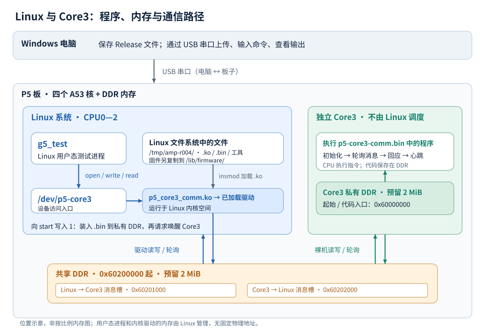
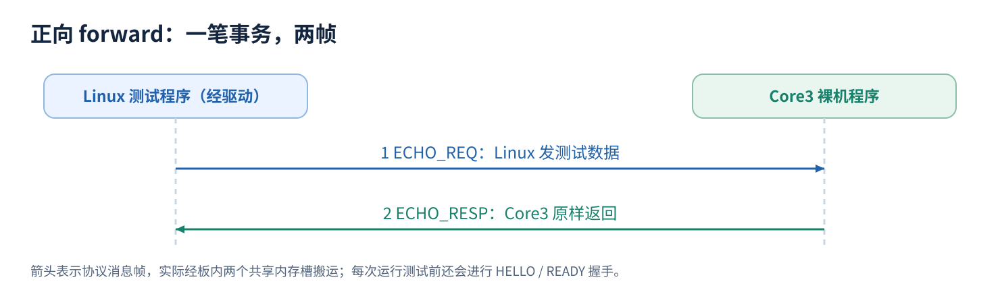
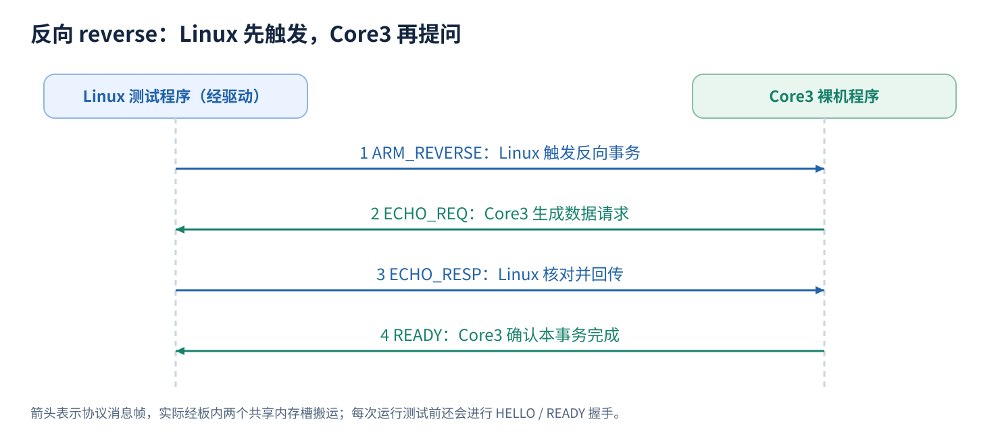
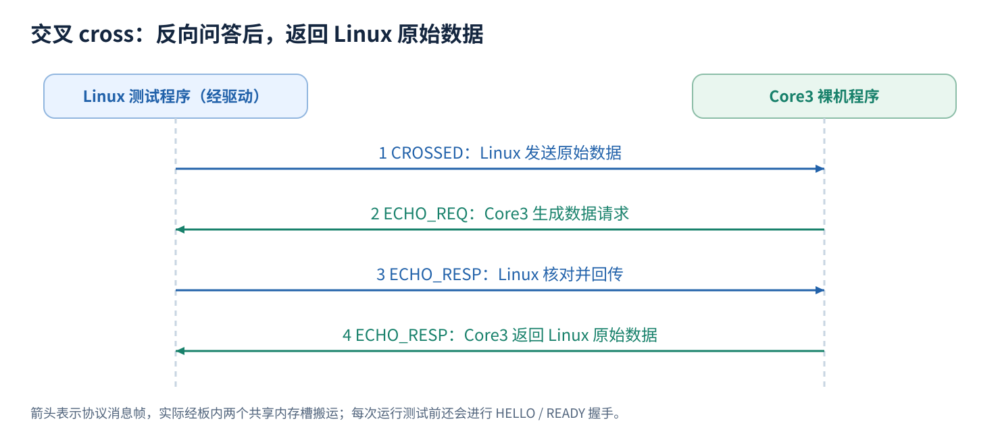

# Linux与Core3如何建立通信，以及我们怎样证明它能工作

这份文档面向第一次接触P5（XCZU4EV）项目的成员。读完后，应能解释一条消息经过哪些程序和内存、为什么需要那些部署命令，以及测试输出能支持什么结论。具体命令和停止条件仍以[通信构建与手动加载指南](build/AMP-REPRODUCE.md#板端手动启动)为准；阅读本文不需要重新操作板子。

适用组合是r001基础启动包＋r004通信载荷。这里的r001、r004是实验修订编号。本文对照最终源码解释机制，并用2026-10-31首次使用者手动复现时贴出的结果说明验证方法；这次结果只覆盖正常通信短测。

## 1. 先认清通信的两端和中间的通道

板上有四个A53处理器核。CPU0—2共同运行一个Linux系统，Linux统一调度它们；Core3独立运行一份裸机程序，也就是不依赖Linux操作系统、自己初始化后循环工作的程序。这种不同核分开运行不同软件系统的安排称为AMP（非对称多处理）。

Linux侧分为两层：用户态测试程序负责提出请求和判断答案；内核驱动负责访问预留内存、启动Core3、搬运消息并检查通信状态。裸机程序在Core3上处理消息。两端实际交换数据的通道，是它们都能访问的一块DDR内存。



图中的USB串口负责电脑与板子之间的操作。测试开始后，Linux与Core3的消息在板内通过DDR交换，不经过USB串口。SD卡提供启动文件；它也不是两核之间的消息通道。

`/dev/p5-core3`是Linux驱动提供给用户态程序的访问入口。它看起来像文件路径，但对它执行`write`会进入驱动的发送逻辑，执行`read`会取得驱动保存的应答。测试程序不直接访问物理地址。

### 图里的程序和接口分别是什么

先区分“文件放在哪里”和“程序在哪里运行”：`/tmp/...`是Linux文件系统路径，`0x60000000`是板上DDR物理地址，CPU0—2／Core3则是执行指令的处理器核。三者不是同一类位置。以下路径对应本次手动部署。

| 名称 | 简单理解 | 文件在哪里 | 加载／运行后在哪里 |
| --- | --- | --- | --- |
| `g5_test` | 编译好的Linux测试可执行文件；负责造消息、调用驱动、核对应答并打印统计 | 板端`/tmp/amp-r004/g5_test`；源码在`amp/linux-g5/g5_test.c` | 运行后成为Linux用户态进程，由Linux调度到CPU0—2执行；代码和数据所在内存由Linux管理，没有本实验指定的固定DDR物理地址 |
| `/dev/p5-core3` | 驱动注册的字符设备节点，是用户程序访问驱动的入口 | 板端Linux的`/dev/`目录 | 访问会进入Linux内核中的驱动函数；这个节点不是裸机程序，也不是存放消息的普通文件 |
| `p5_core3_comm.ko` | 可加载的Linux内核模块，`.ko`表示内核模块文件；替测试进程访问预留DDR，并提供Core3启动和状态接口 | 板端`/tmp/amp-r004/p5_core3_comm.ko`；源码主体在`amp/linux-g4/` | `insmod`后，代码被装入Linux内核空间，在CPU0—2上的内核执行上下文中运行；模块内存由Linux管理，不是Core3私有区 |
| `p5-core3-comm.bin` | 给独立Core3执行的裸机机器码；不作为Linux进程运行 | 先在`/tmp/amp-r004/`，再复制到`/lib/firmware/p5-core3-comm.bin`；源码在`amp/core3-g4/` | 第5步启动请求时，驱动才把字节复制到DDR物理地址`0x60000000`；Core3随后从该入口执行，使用预留的私有区 |

`g5_test`中的G5来自历史验证阶段“Gate 5”的命名；它是工具名称，不能仅凭运行了这个工具就说完成了全部G5长测验收。

`open`、`write`、`read`是`g5_test`调用的Linux文件／设备访问接口，调用后由系统调用机制进入内核。它们不是三个独立程序，也不是三条核间通信线路：

| 接口 | 在本项目中的含义 |
| --- | --- |
| `open("/dev/p5-core3", O_RDWR)` | 以可读写方式打开通信设备，成功后取得文件描述符`fd`，即后续操作这个设备的整数句柄；驱动限制同一时间只有一个客户端打开 |
| `write(fd, 请求帧, 长度)` | 把已经按协议编码的请求交给驱动；驱动发布到共享内存，并等待下一条协议响应帧到达自己的缓冲区 |
| `read(fd, 接收缓冲区, 容量)` | 从驱动取出刚才保存的响应帧，测试程序随后检查消息关系及数据内容 |
| `close(fd)` | 释放这个客户端的设备访问；不关闭Linux，也不停止Core3 |

这里`write`的目标是设备节点，所以行为由驱动实现决定，不能按“往普通文件追加文本”理解。整个消息流程的编码、检查和多步交互已写在`g5_test`内部，操作人员不需要手动分别输入这些接口调用。

程序执行时，指令和数据主要保存在板上DDR中，由相应CPU取指和处理；“在Core3上运行”指执行者是Core3，不表示整个程序文件永久存放在CPU核内部。图中的Linux区域表示软件管理范围，内核空间与用户空间的区别也不代表它们各占一个固定CPU核。

## 2. 为什么要准备两块内存、两组文件

### 两块内存解决“代码放哪、数据放哪”

| 区域 | 地址范围（左闭右开） | 大小 | 用途 |
| --- | --- | --- | --- |
| Core3私有区 | `[0x60000000,0x60200000)` | 2MiB | 放置裸机代码、栈和运行数据 |
| 两端共享区 | `[0x60200000,0x60400000)` | 2MiB | 放置状态、心跳、计数及消息槽 |

设备树是Linux启动时读取的硬件和资源配置。r001通信基础镜像的设备树把这两区预留出来，并设置`no-map`，避免它们作为普通内存参与Linux的常规分配和默认映射。通信驱动再按实验要求显式映射并访问它们。

预留内存相当于先划出双方约定的场地。它不会自动启动Core3，也不会自动产生消息。原始RT（实时内核）镜像不带本实验的这套预留，因此不能只看到Linux运行三核，就认为通信环境已经准备好。

### 两组文件解决“系统先启动、通信程序后加载”

| 文件或目录 | 所在位置与作用 |
| --- | --- |
| `sd-base-r001/` | 基础启动文件部署到SD卡，让Linux以匹配的三核和内存配置启动 |
| `ram-r004/p5-core3-comm.bin` | 上传后是板端文件；启动请求时，驱动才把其中的裸机机器码复制到Core3私有区 |
| `ram-r004/p5_core3_comm.ko` | Linux内核模块；加载后提供启动、状态及消息访问入口 |
| `ram-r004/g5_test` | 在Linux用户态运行的测试工具，构造请求并核对应答 |
| `ram-r004/g5_snapshot` | 在Linux用户态读取驱动和共享状态中的计数，供前后比较 |

把`.bin`上传到`/tmp/amp-r004/`，只是让Linux文件系统中有了这个文件。复制到`/lib/firmware/`，只是把它放到驱动查找固件的位置。这两步都没有让Core3执行它。这里的“固件”指供Core3运行的程序字节，不表示它已经烧进非易失存储。

## 3. 从上电到可以发送消息，中间发生了什么

把操作指南六步与内部变化对照起来，就能知道每条命令在建立哪一部分条件。

| 操作指南步骤 | 内部变化 | 这一步还不能证明什么 |
| --- | --- | --- |
| 1. 串口传输 | 四个文件进入板端Linux文件系统 | Core3尚未运行这些文件 |
| 2. 核对SHA-256 | 确认文件字节与指定发布版本一致 | 文件一致不代表程序已运行 |
| 3. 核对启动环境 | 确认内核、Linux CPU集合、启动参数、内存地址及`no-map`满足前提 | 内存预留正确不代表Core3已启动 |
| 4. 复制固件并`insmod` | Linux加载驱动，驱动检查资源、映射预留DDR，注册设备和状态入口，并准备心跳监测线程 | 驱动明确保持Core3未启动 |
| 5. 向`start`写入1 | 驱动装入裸机代码，请求平台固件唤醒Core3；Core3初始化并进入轮询循环 | 启动成功和有心跳还不能证明业务消息内容正确 |
| 6. 运行短测 | 测试工具建立消息会话、发送不同模式的数据并检查结果 | 正常短测不能替代故障恢复、长测或产品验收 |

### 第4步：Linux侧先准备好入口

`insmod`加载的是Linux驱动。驱动依据设备树核对两块内存的地址、大小及`no-map`，检查Linux的CPU配置，再建立映射和`/dev/p5-core3`等入口。

本次启动前看到：

```text
fault_tests=N
attempted=0 result=0 pm_query=0 pm_state=0
magic=ffffffff version=4294967295 ...
```

`fault_tests=N`表示故障注入关闭。`attempted=0`表示未尝试唤醒；`pm_query=0`表示向平台查询电源状态成功；`pm_state=0`在本实验匹配的平台固件中表示Core3处于强制关断状态。

后面的`magic`、`version`等来自共享状态区。Core3尚未初始化它们，此时看到全为`f`的值或巨大整数，不应按启动后的正常状态标准判断。驱动将在第5步启动流程中清理相关区域。这里的`result=0`也不能单独解读成“已经启动成功”，必须结合`attempted`看。

### 第5步：装入代码，再请求Core3从入口执行

向`/sys/bus/platform/devices/core3-heartbeat/start`写入`1`，触发驱动的启动函数。它会检查未重复尝试启动、查询Core3确实关断，然后：

1. 从`/lib/firmware/p5-core3-comm.bin`读取固件文件。
2. 清理相关私有区和共享状态区，写入来自Linux的计数器频率提示。
3. 把固件字节复制到`0x60000000`，读回比较。
4. 通过平台电源管理接口，请求PMU固件唤醒Core3，并指定入口`0x60000000`。

PMU固件是平台上负责相关电源管理操作的固件。Linux驱动通过它请求唤醒Core3；Linux并没有把Core3当成自己的第四个调度核。

Core3从入口执行后设置栈、异常入口和内存映射，初始化通信状态，再进入“检查消息、处理消息、更新心跳”的循环。当前实现对相关DDR采用配套的非缓存访问配置，并用内存屏障约束数据与发布标志的先后顺序；不能把任意一块普通内存随意改成共享区就认为等价。

本次启动后的关键值是：

```text
attempted=1 result=0 pm_query=0 pm_state=1
magic=504d4143 version=4 core=3 el=12
heartbeat=20 state=1 reason=0 esr=0 elr=0 far=0
```

这组值共同表明启动请求成功，Core3写出了r004状态页。`state=1`表示裸机程序进入运行状态，`reason=0`表示没有报告故障原因；`esr`、`elr`、`far`分别保存异常综合信息、异常返回地址和故障地址，本次均为0。`el=12`是CurrentEL寄存器对EL3的编码，不是名为“EL12”的异常级别。状态页版本4与下面消息帧的线格式版本1是两种不同版本。

此后快照中的Core3心跳从698增至920，Linux心跳从647增至852，说明双方在这段观察期内仍有进展。心跳是独立的存活证据，消息正确性还要继续测试。

## 4. 一条消息怎样穿过共享内存

共享区里两个方向各有一个消息槽。Linux发送槽从`0x60201000`开始，Core3发送槽从`0x60202000`开始，地址来自共享区基址加上协议中的偏移。这不是两条能无限积压消息的队列，每个方向同一时刻只能协调使用一个槽。

可以把每个槽理解为一张可反复使用的留言纸，旁边有“已发布到第几次”和“已读到第几次”两个数字。实际字段叫`publish`和`ack`，记录的是槽的传输代次。

以Linux发送一条正向请求为例：

1. 测试程序把请求编码成消息帧，通过`write(/dev/p5-core3)`交给驱动。
2. 驱动确认上一条已被消费，把完整帧写入Linux发送槽，再更新`publish`表示有新消息。
3. Core3在循环中轮询`publish`。发现新代次后，把帧复制到自己的缓冲区，再更新`ack`表示这个槽已经被消费。
4. Core3检查消息格式、CRC、会话等，再处理有效请求，将应答写入反方向的槽并发布。
5. Linux驱动轮询到应答，把帧复制到自己的缓冲区、确认消费并校验，再交给测试程序。

“槽已经消费”的`ack`只表示对方已经取走帧，发送方可以按协议复用槽；它不等于“请求内容正确并已完成”。后者需要有效的应答及测试程序核对。

当前Linux驱动的`write`会等待并收取下一条协议响应帧，保存到驱动缓冲区；随后的`read`再把这帧交给用户态测试程序。这不一定代表整笔事务结束：反向测试的第一次`write`等到Core3的`ECHO_REQ`就返回，工具随后还要调用下一次`write`回传数据，才能取得最终`READY`。这里的等待通过轮询实现，Linux侧等待循环会短暂休眠，Core3在自己的循环中检查；没有使用消息通知中断，也没有采用RPMsg处理器间消息框架。

### 消息帧为什么不只放一段数据

每帧包含40字节头部，以及0—256字节有效载荷。除了数据，还需要双方共同理解的协议字段：

| 字段 | 解决的问题 |
| --- | --- |
| magic、version、长度 | 这是否是本协议支持、边界合理的一帧 |
| CRC（循环冗余校验） | 这帧头部和有效数据是否发生了可检测的损坏 |
| session（会话标识） | 这条消息是否属于当前这次测试会话 |
| seq（消息序号） | 对方发来的顺序是否符合预期，是否重复或跳号 |
| correlation（关联序号） | 这条应答是在回答哪一条请求 |
| epoch（服务状态版本） | 消息是否仍属于当前的通信服务状态，是否混入重置前的旧状态 |

槽的传输代次、消息序号、会话标识和epoch各自解决不同的问题。CRC正确也不保证消息属于当前会话，所以通过解码后还必须检查上层协议关系。这里的服务重置更新通信状态，不能等同于Core3硬件复位。

## 5. 每次测试都先握手，再核对一笔笔事务

启动Core3建立了运行前提；具体测试会话由测试工具另行建立。每次启动`g5_test`进程都会打开设备、生成一个新的session，发送`HELLO`消息。Core3接受后回复`READY`，并带回当前epoch；工具检查关联关系并保存epoch，后续消息使用它。

`boot_token`是Core3启动时从计数器取得的本次启动标识，不是持久化的开机次数。`service_epoch`是共享状态中的通信服务版本，也是消息帧中的epoch；它初始取自boot_token，通信服务重置时可以改变而不重启Core3。

本次三个模式输出的session各不相同，但epoch都是`135520954334`。这表示建立了三个测试会话，期间通信服务状态版本没有变化；运行三次测试并不意味着重新启动了三次Core3。

一次“事务”指完成某个模式所要求的整组请求和应答。一个事务可能需要两帧，也可能需要四帧。下面省略了每帧经过驱动和消息槽的中间搬运过程。

### 正向forward：Linux发数据，Core3原样回答



工具检查应答类型、关联序号、长度和每个数据字节。只收到一个“成功”标志不够，回来的数据也必须与发出去的一致。

### 反向reverse：Linux先触发，Core3生成请求，Linux回应



Core3按约定模式生成数据，Linux核对后回传，Core3再检查回传内容，最后确认完成。这里验证了Core3发起数据请求、Linux作答的路径；本测试仍由Linux发送第一条触发消息，不证明Core3可以不经触发自行向任意Linux程序推送消息。

### 交叉cross：反向问答完成后，再返回原始数据



工具既检查Core3生成的请求，也检查最后返回的Linux原始数据。这样可以验证多步事务中的消息关联和数据保存。当前测试按这条顺序推进；“交叉”这个名字不表示两个独立客户端同时并发发送。

三个模式都会轮换0、1、4、63、64、65、255、256字节长度，并轮换全零、全一、交替位、递增和伪随机等数据模式，检查空载荷、长度边界及不同字节内容。正常短测验证了这些合法消息被正确处理；“故意发送错误CRC是否会被拒收”需要另做故障测试。

## 6. 为什么各测100次，收发计数却都是503

`passed=100`统计完成的测试事务，驱动和Core3的收发计数统计消息帧。每次运行还额外包含一次HELLO／READY握手。按每个方向分别计算：

| 模式 | 测试事务数 | 每事务Linux→Core3帧数 | 每事务Core3→Linux帧数 | 加上握手后，每方向帧数 |
| --- | --- | --- | --- | --- |
| forward | 100 | 1 | 1 | 1＋100＝101 |
| reverse | 100 | 2 | 2 | 1＋200＝201 |
| cross | 100 | 2 | 2 | 1＋200＝201 |
| 合计 | 300 | — | — | 101＋201＋201＝503 |

因此，在本次初始计数为0、只运行这三项测试的条件下，预期是：

```text
linux_tx = core3_rx = 503
core3_tx = linux_rx = 503
```

这不是503个测试事务，也不是两个方向加起来总共503帧。两个方向合计是1006帧。

`g5_snapshot`通过驱动的快照接口读取计数和共享状态，本身不发送HELLO或业务消息，因此前后各取一次快照不会额外增加这四项收发计数。它会打开并关闭设备；下一次测试仍应重新握手，且不能与其他客户端同时占用设备。

如果此前已跑过测试，就比较测试前后的增量，而不要求绝对值仍为503。仅看四个计数相等也不足以证明数据正确，还要结合工具逐笔校验和错误统计。

## 7. 把这次输出拼成一条完整的证据链

本次手动复现给出了以下结果（[用户提供的输出摘录](../logs/amp/2026-10-31/manual-short-test-user-excerpts.txt)，由聊天粘贴内容转录，非完整串口日志）：

| 证据 | 实际观察 | 可以支持的结论 |
| --- | --- | --- |
| 四个文件摘要 | 与发布版本逐项一致 | 使用了指定版本的载荷和工具 |
| 启动前状态 | `attempted=0 pm_query=0 pm_state=0`，故障测试关闭 | 尚未唤醒Core3，平台查询符合本实验启动前提 |
| 启动后状态 | 请求返回0，状态页版本4、core=3、state=1、reason=0，异常字段为0 | Core3已经执行并发布正常状态 |
| 存活进展 | Core3心跳698→920，Linux心跳647→852 | 观察期间双方仍在更新心跳 |
| 消息正确性 | 三种模式均`passed=100 errors=0` | 各模式100笔事务完成并通过工具的协议及数据检查 |
| 前后计数 | 四项收发计数均0→503 | 与握手和三种事务帧数吻合，两端收发对应 |
| 异常与连续性 | 错误、超时、失联、重置计数均0；boot_token及service_epoch前后相同 | 本观察范围没有记录到这些异常或标识变化 |

这条链比“命令没报错”更有说服力：身份正确、启动状态合理、双方有进展、数据逐笔正确、计数能解释，并且没有记录到相关异常。启动环境检查的命令和标准在操作指南第3步；本次聊天未提供该步完整输出，本文不将它写成已经独立核验的证据。

### 延迟数字在测什么

本次forward、reverse、cross的`max_us`分别为856、1349、1722微秒。计时由Linux测试程序在一笔事务开始前和完成后取单调时钟，因此包含系统调用、驱动轮询等待、共享内存搬运、Core3处理，以及Linux运行时的调度等影响。reverse和cross还包含更多帧。

这不是单次DDR访问耗时，也不是Core3内部算法的单独执行时间；三种模式测量的事务不同，不能把最大值直接当成同一种指标比较。工具按10毫秒目标间隔安排事务，`missed_release=0`表示按它的算法未记录到错过的后续发起时隙，不表示所有调度抖动均为零，也不表示满足某个尚未定义的控制周期要求。每模式100笔时，p99、p999对极少数样本很敏感，不能作为长期尾部保证。

`g5_test`另把逐笔纳秒耗时写入板端`/tmp/amp-g5-forward.latency-ns`等文件；同模式再次运行会覆盖同名文件，断电也会丢失。需要保留证据时，应在重测或关机前把它们和串口输出保存到本次独立结果目录。本次只收到聊天粘贴的输出，尚未取得这些逐笔延迟文件或完整串口日志；摘录链接不能替代尚未归档的原始文件。

## 8. 做完这次复现，你应该能回答什么

无需背命令，先用自己的话回答以下问题，再对照相应章节：

1. USB串口、SD卡、共享DDR分别承担什么角色？（第1、2节）
2. 为什么上传bin、复制到固件目录、加载ko后，Core3仍可能没有运行？（第2、3节）
3. 谁发现新消息，谁确认消息槽已消费，谁判断应答内容正确？（第4、5节）
4. 心跳在增长，为什么还要运行消息测试？（第3、7节）
5. 反向测试由谁触发？交叉测试是否证明独立客户端并发？（第5节）
6. 为什么300笔测试对应每方向503帧？（第6节）
7. 三种短测通过后，还有哪些问题没有验证？（本节下文）

本次可以得出的结论是：在这块匹配的P5板、这套基础镜像和r004程序、这次运行条件下，Linux与Core3能够建立会话并完成三种正常双向通信短测。长时间稳定性、故障恢复、重复冷启动，以及真实电机控制和产品硬实时要求，需要各自的条件与证据。仓库历史G0—G5（Gate，六个验证关卡）验收记录仍保留原日期和范围，不因本次短测通过而变成本次重新验收。

断电后，SD卡上的r001仍在，Core3运行状态和共享内存状态不保留。按本指南上传到`/tmp/amp-r004/`的文件属于临时文件，需重新上传；本实验使用的基础镜像以initramfs（装入内存的根文件系统）启动，运行中复制到`/lib/firmware/`的文件也需重新准备。其他持久化部署方式不能直接套用这一文件保留结论。已经启动Core3时，不热卸载通信模块、不重复唤醒、不强制复位；恢复方法按操作指南执行。

## 源码与继续阅读

本文的机制解释对应以下文件，读源码时可从列出的函数开始：

| 想核对什么 | 源码／文档 |
| --- | --- |
| 内存地址、大小、设备树绑定 | [内存预留配置](../configs/p5b-amp-memory.dtsi) |
| 加载与唤醒Core3、启动前后状态 | [Linux驱动](../amp/linux-g4/p5_core3_comm.c)：core3_probe、start_store、status_show |
| 消息槽搬运、阻塞write、快照及心跳 | [Linux通信逻辑](../amp/linux-g4/ipc_linux.h)：ipc_write、ipc_read、ipc_ioctl、heartbeat_thread |
| Core3入口、状态发布和主循环 | [裸机启动程序](../amp/core3-g4/start-comm.S) |
| Core3握手、消息处理和槽确认 | [裸机通信程序](../amp/core3-g4/ipc.c)：amp_ipc_init、amp_ipc_poll、flush |
| 帧格式、CRC、槽偏移 | [协议说明](../amp/protocol/README.md)、[帧定义](../amp/protocol/amp_wire.h)、[编解码](../amp/protocol/amp_wire.c)、[槽布局](../amp/protocol/amp_slots.h) |
| 三种测试、计时和数据判定 | [g5_test.c](../amp/linux-g5/g5_test.c)、[g5_snapshot.c](../amp/linux-g5/g5_snapshot.c) |
| 实际部署与后续验收 | [手动操作指南](build/AMP-REPRODUCE.md)、[历史阶段总览](reports/amp-stage-summary-20261030.md) |
