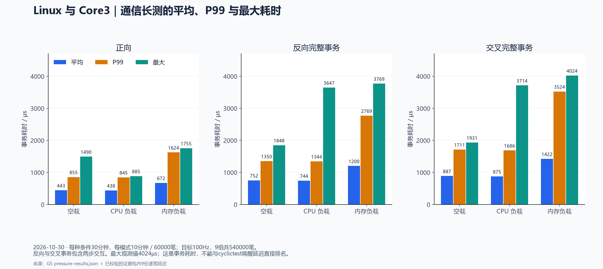
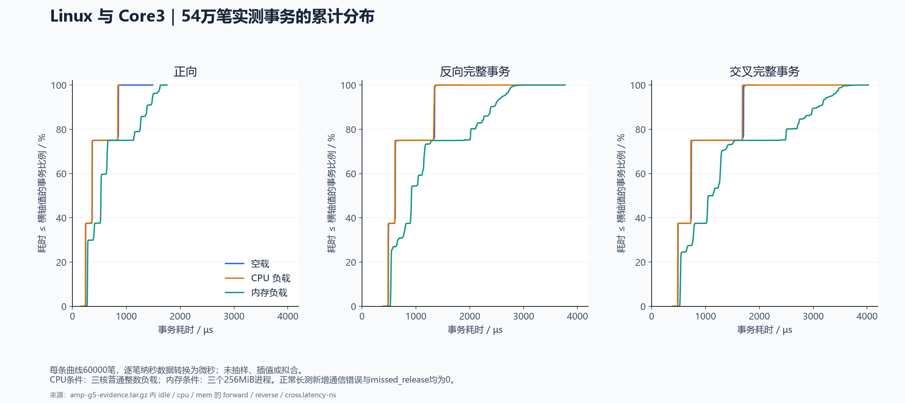

# P5 Linux ↔ Core3 裸机通信阶段成果

2026-10-30，P5（XCZU4EV）学习板的 **G0—G5（G 为 Gate，表示六个验证关卡） 最小通信实验验证完成**：Linux 使用 A53 CPU0—2，Core3 运行独立裸机通信程序，通过专用共享内存双向收发。现有控制业务、速度环／位置环和电机未接入本实验，产品核心板与硬实时指标未验收。

当前组合是 **r001（本实验第1次修订的基础启动版本） SD 基础镜像＋r004（本实验第4次修订的通信驱动与裸机程序版本） RAM 驱动／固件**。驱动加载后不会自动启动 Core3；确认其关断后，由 Linux 显式请求 PMU（Platform Management Unit，平台管理单元，此处用于 Core3 电源管理与唤醒） 单次唤醒。r004 断电丢失，重启需手动重载。用户已决定暂缓持久化启动包和自动启动，本轮不增加这些功能。

## 实现与验证范围

| 项目 | 实际实现／检查 |
| --- | --- |
| 内存归属 | 私有区 `[0x60000000,0x60200000)`、共享区 `[0x60200000,0x60400000)`，设备树（Device Tree，向 Linux 描述硬件配置和资源归属的数据）均 `no-map` |
| 数据可见性 | 双方 Normal-NC（Normal Non-cacheable，普通、非缓存的内存映射属性）、Inner-shareable（允许同一内部共享域内的核按共享规则访问的内存属性）；Core3 不初始化共享 GIC（Generic Interrupt Controller，通用中断控制器）、UART、DMA 或时钟，不做共享 L2 全局维护 |
| 首条链路 | 共享内存轮询，每方向一个消息槽，发布序号／确认控制槽所有权；未引入 RPMsg（Remote Processor Messaging，处理器间消息通信框架） 或通知中断 |
| 消息 | 40 字节头、最多 256 字节载荷，小端编码、CRC（Cyclic Redundancy Check，循环冗余校验，用校验值发现消息数据损坏）、会话、服务 epoch（通信服务状态的版本标识，服务重置时更新）、序号及关联序号校验 |
| 生命周期 | 启动前检查 PMU 关断；启动后模块保持引用，不热卸载、不强制复位 Core3、不自动重试启动 |
| 实验参数 | 目标 100Hz、事务超时 100ms、心跳目标 100ms 更新、1s 不变判失联、恢复握手观察窗口 2s |

裸机状态页版本为 4，消息线格式版本为 1，两者含义不同。服务重置只清理通信状态并更新 epoch，不等同于硬件 Core3 复位。反向测试由 Linux 的 ARM_REVERSE 指令触发，不代表裸机自主周期业务推送；反向和交叉事务均包含两步交互。

## G0—G5 结果

G 表示 Gate，即进入后续验证前的检查关卡。以下结论只针对本实验条件；早期记录中的“尚未完成”保留当期语境。

| 关卡 | 内容 | 最终结果／证据 |
| --- | --- | --- |
| G0 | Core3 启动、异常级别、内存与资源共存路径 | Linux 启动后经 PMU 唤醒 Core3 的路径落实，见[启动审查与修正记录](../../logs/amp/2026-10-30/g0/r002-progress.md) |
| G1 | 独立实验包构建、ELF（Executable and Linkable Format，可执行与可链接格式，可记录程序入口和内存布局）／模块／DT（Device Tree，设备树，描述硬件及资源配置）／FIT（Flattened Image Tree，把内核、设备树等载荷组织在一起的启动镜像格式） 离线检查 | r001 基础镜像及后续 RAM 载荷分别校验；不是将 r004 写入 SD |
| G2 | 最小心跳共存 | r002（本实验第2次修订的心跳程序版本） RAM 心跳 600.14s、21 个采样点，计数增长 6001，见[结构化结果](../../logs/amp/2026-10-30/g0/r002-coexist-results.json) |
| G3（检查双向消息正确性） | 双向消息正确性 | 正向 10000、反向 10000、交叉 100 次，加各模式 48 次短测；双向各 30446 帧，错误／超时为 0，见[G3 报告](amp-g3-validation-20261030.md) |
| G4（检查故障识别与恢复） | 故障识别与恢复 | 250 个复合用例通过，覆盖坏帧、旧会话、回绕、背压、暂停、程序终止、服务重置和双向心跳，见[G4 报告](amp-g4-validation-20261030.md) |
| G5 | 长测及重复启动 | 三种条件各 30 分钟、540000 个正常事务；另做程序重启 10 次、服务重置 10 次、冷启动 5 次，见[G5 报告](amp-g5-validation-20261030.md) |

G4 及 G5 恢复用例主动制造超时、拒收等错误，计数按预期核对；“无新增通信错误”仅用于 G5 正常长测，不能将故障注入阶段概括为零错误。

## 性能实测与边界

下表每格为平均／P99（99th Percentile，第99百分位数，约99%的样本不超过的统计值）／最大值，单位 µs，每种条件每个模式 60000 次。所有模式 missed_release 为 0；逐笔延迟与板端摘要校验后独立重算一致。

| 条件 | 正向 | 反向完整事务 | 交叉完整事务 |
| --- | --- | --- | --- |
| 空载 | 443／855／1490 | 752／1350／1848 | 887／1711／1931 |
| CPU | 438／845／885 | 744／1344／3647 | 875／1686／3714 |
| 内存 | 672／1624／1755 | 1200／2769／3769 | 1422／3524／4024 |

CPU 条件为 CPU0—2 各一个 SCHED_OTHER 整数负载；内存条件为三个各 256MiB 的填充／复制／比较进程，总计 768MiB。两种条件下三核平均忙碌率均为 100%。这是有限时长的软件事务测量，最大 4.024ms 不是已证明的最坏上界，也不支持 1ms 产品截止时间承诺。

累计分布使用全部540000笔原始延迟；图表与数据来源见[完整图集](test-results-visualization-20261031.md)。

原始 RT 初测的 1255／1293µs 是 **cyclictest 唤醒延迟**，与本表的通信事务耗时不同。AMP（Asymmetric Multiprocessing，非对称多处理，不同处理器核运行不同的软件系统） 长测通过不代表原始 RT 的唤醒尖峰问题已定位或修复，详见[RT 测试总结](rt-assessment-summary-20261029.md)。

## 证据、复现与当前状态

- [复现与手动加载方法](../build/AMP-REPRODUCE.md)：版本、源码目录、构建输入与单次启动流程。
- [G5 汇总结果](../../logs/amp/2026-10-30/g5/results.json)、[压力测试独立结果](../../logs/amp/2026-10-30/g5/pressure-results.json)、[五次冷启动结果](../../logs/amp/2026-10-30/g5/cold-results.json)。
- [完整长测／恢复证据包](../../logs/amp/2026-10-30/g5/amp-g5-evidence.tar.gz)：SHA-256（计算文件摘要的算法，用于核对文件内容是否一致） `71f57d5b98ab1f1a3f988d0c08bcf897be70880986b8b04a19207adba4dac020`；保留每块及整包校验记录。
- [最终现场](../../logs/amp/2026-10-30/g5/final-state.txt)：Linux CPU0—2、Core3 RUNNING，故障注入关闭，无 G5 测试或负载进程残留；串口与电源未在本次文档整理中操作。

第五次冷启动监听在用户上电前超时，缺少 FSBL（First Stage Boot Loader，上电后负责早期硬件初始化的第一阶段启动程序）／U-Boot（Universal Boot Loader，加载并引导 Linux 的启动程序） 日志；保留了约 2.6s 起至提示符的 Linux 启动记录、用户断电确认、Core3 关断检查及成功通信结果。该采集缺口不写成完整早期启动追踪。五次冷启动验证的是人工重载流程，未验证开机自动恢复通信。

后续业务协议、Linux 指令解析应用、真实控制环、外设及端到端截止时间分别验收；本阶段成果不替代这些工作。
