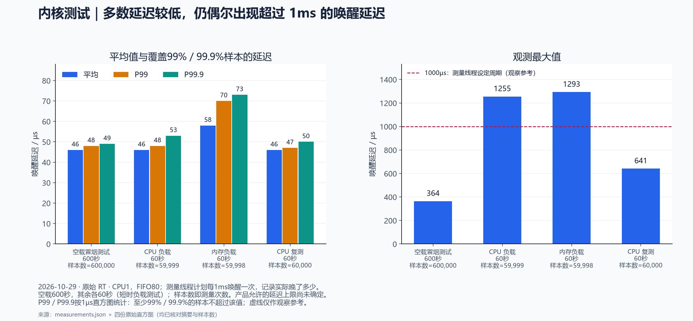
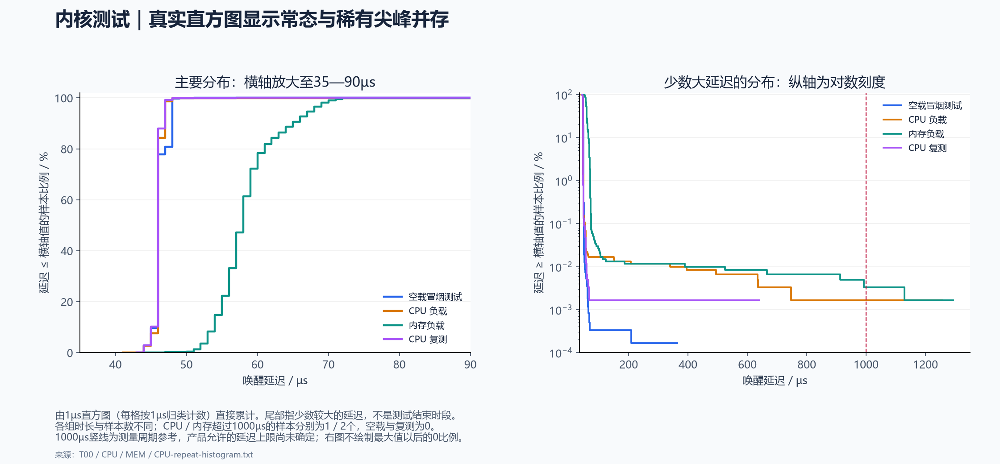
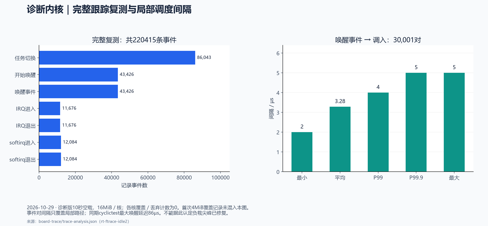

# PREEMPT_RT 测试方法与结果

本页保留2026-10-29的内核测量结果与当期现场状态。2026-10-30另行完成了Linux与Core3最小通信验证，后续状态见[通信阶段成果](amp-stage-summary-20261030.md)。下文“AMP未验收／板子保留诊断版”指当时状态；内核唤醒尖峰问题仍未关闭，内核唤醒长测与已经完成的通信长测分别记录。

日期：2026-10-29。实测对象为 P5 XCZU4EV 学习板，Linux 运行于 A53 CPU0—2，Core3 未启动裸机。已完成系统级初测，尚未部署实际控制算法或验收闭环。

**主要结果：** 原始 RT 的 CPU／内存各 60 秒短时负载测试的最大唤醒延迟为 1255／1293µs，原因未定位；诊断版已验证 ftrace 事件采集和 A53 PMU，10 秒空载完整复测同期最大延迟 86µs。两组条件不同，不能认定性能改善。futex／JBD2 修复差异仍待审查，没有充分依据直接决定升级 5.4.3，也没有通过产品实时验收。

## 1. 三种工具各回答什么问题

| 工具 | 测试对象与方法 | 本次输出 | 用途与限制 |
| --- | --- | --- | --- |
| cyclictest（rt-tests） | 周期测试线程：预定唤醒后读取实际时间 | 唤醒延迟分布、平均、分位数、最大值和超阈值次数 | 判断系统是否出现晚唤醒；不测真实算法耗时、通信或闭环 |
| ftrace | 内核跟踪框架，通过 tracefs 记录带时间戳的调度／中断事件 | 谁唤醒线程、何时切入、IRQ／softirq 上下文、缓冲区完整性 | 在同一时间窗口调查等待和干扰；本轮未采全量函数或锁路径 |
| perf | Linux 性能分析工具，使用软件事件或 CPU PMU，支持累计计数与抽样 | CPU 时间、切换、迁移、缺页、硬件事件、采样热点 | 找资源消耗和热点；累计次数不能单独解释某一次延迟尖峰 |

三者可以组合：cyclictest 先发现晚唤醒，ftrace 对齐该时间段查调度与中断，perf 检查负载和热点。它们没有天然固定到某个控制环；具体测试对象由被测线程、事件范围、CPU 绑定和运行场景决定。PMU 是硬件计数单元，不是第四个测试软件。

系统初测现在就能做。算法部署后，还要测实际任务的释放、开始、完成与端到端通信时刻；闭环验收则需要真实算法、外设、执行器及业务指标就绪。

## 2. 环境与可比性

| 项目 | 原始 RT 基准 | 独立诊断内核 |
| --- | --- | --- |
| release | `5.4.0-rt1-xilinx-v2020.2-p5b` | `5.4.0-rt1-xilinx-v2020.2-p5b-diag-ftrace` |
| 配置 | PREEMPT_RT，3 核；原配置无 FTRACE／ARM_PMU | 增加 ftrace、调度／系统调用跟踪及 ARM_PMU，重建 62 个匹配模块 |
| image.ub SHA-256 前缀 | `f7c224640ad3…` | `c81f2203d00d…` |
| 用户空间 | 原镜像 Bash，未加载交互增强插件 | 保留原用户空间，增加手动运行的诊断工具 |

独立诊断内核用于增加观测能力：启用 ftrace、调度／系统调用跟踪和 ARM PMU，并重新构建匹配的模块。它的完整内核版本（`uname -r` 输出）为 `5.4.0-rt1-xilinx-v2020.2-p5b-diag-ftrace`；增加后缀是为了区分版本，实际配置和二进制也有变化。已测镜像可从[诊断 Release](https://github.com/maxwell-motion-measurement-rd/p5b-linux-rt/releases/tag/diagnostic-ftrace-20261029)下载，按[诊断部署指南](../DIAGNOSTIC-DEPLOY.md)校验、部署和回退，无需重新编译。诊断 ZIP 不包含 BOOT.BIN／boot.scr，需配合已验证的原始 RT 启动文件；包内工具与匹配模块已打入 image.ub。需要修改配置或从源码重建时，再按[诊断构建步骤](../build/REPRODUCE.md#从原始流程生成诊断内核)准备 BSP、工具链和 rootfs 输入。包内“尚未上板”为历史状态，旧采集脚本的 4MiB 参数与完整复测的每核 16MiB、mono 时钟须区分。

两版 DTB、BOOT.BIN、boot.scr 保持原字节。频率策略为 userspace，观测频率 1199999kHz；RT period/runtime 为 1000000/950000µs。未为降低延迟修改 CPU 隔离、IRQ 亲和性或 PM QoS；未做非 RT 性能对照。

厂商基线为 `62ea514294a0c9a80455e51f1f4de36e66e8c546`，RT 提交为 `e4cc2d02d270570055fe2b46ca2eb17c21938504`。使用 5.4.3-rt1 移植输入，源码仍为 5.4.0，不应把补丁名当作稳定版本升级证明。BSP 的 P5B 名称不改变实板为 P5 的事实。

比较结果前，必须对齐镜像、配置、频率、负载、时长、CPU 绑定和跟踪开关。诊断有观测开销；当前没有足够的配对实验分离这些因素。

## 3. cyclictest：唤醒延迟有多长

### 方法与指标

使用 rt-tests 1.0，以 NUMA=0 构建，未修改测量代码。单线程绑定 CPU1，SCHED_FIFO 优先级 80，1ms 周期，mlockall，CLOCK_MONOTONIC 绝对睡眠，2000µs 直方图，静默输出。`--laptop` 在此版本用于跳过 cpu_dma_latency 写入。

延迟为“读取实际时间 − 预定唤醒时间”，包含定时唤醒到用户线程获得执行并读时钟的路径，不等于算法执行时间。

| 指标 | 含义 | 怎样判断 |
| --- | --- | --- |
| 样本数 N | 实际完成的测量次数 | 用于确认覆盖范围；相近样本数不保证稀有竞争已覆盖 |
| min／avg | 观测最小值／平均值，单位 µs | 描述常态；较低平均值不能抵消偶发严重超时 |
| P99／P99.9 | 至少 99%／99.9% 样本不超过的延迟值，按 1µs 精度直方图统计 | 描述分布尾部，仍有剩余样本可能更差 |
| max | 本窗口观测到的最大延迟 | 是发现的下界证据，不是已证明的最坏情况上界 |
| >1000µs 次数 | 唤醒延迟严格大于 1000µs 的样本数 | 表示晚醒量超过一个周期；不直接等于产品漏周期或截止时间违约次数 |
| 直方图溢出 | 超过直方图记录范围的样本 | 非零时不能只据桶内分位数评价尾部，须结合溢出数与 max |

P99／P99.9 由 1µs 直方图按最近秩计算，平均值采用工具打印的整数值。退出码与直方图完整性是有效性检查，不能作为实时性能合格线。

### 术语与读图说明

- **短时负载测试（原文简称“短负载”）**：指施加负载的时间较短，不表示负载强度低。本次 CPU 和内存场景各持续 60 秒；CPU0、CPU2 的整数运算在采样时接近满载，内存场景在 CPU2 对两个 64MiB 缓冲区反复拷贝。同时在 CPU1 测量唤醒延迟，CPU 场景另复测 60 秒。
- **尾部延迟**：延迟分布中少数较大的值，不是测试结束前的一段时间。多数样本为几十微秒，CPU 首测和内存场景仍分别出现 1255µs、1293µs 的大延迟；平均值低或 P99 较低不能排除这些少见情况。
- **测量周期（原图称“探针周期”）**：cyclictest 测量线程按计划每隔 1ms 唤醒一次，再读取实际时间并计算与预定唤醒时间的差。例如预定在 10ms 唤醒，实际在 10.05ms 读取时钟，则延迟为 50µs。周期是计划唤醒间隔，延迟是每次晚了多少，两者含义不同。
- **观察参考值与产品验收标准（原图称“非产品验收线”）**：图中的 1000µs 虚线取自测量线程的 1ms 设定周期，只用于观察大延迟。项目尚未确定产品允许的延迟上限；超过虚线值得调查，但不能直接判定产品不合格，全部低于虚线也不等于产品合格。实际验收还要考虑算法执行、通信和业务截止时间。
- **样本数 N**：实际记录的唤醒延迟测量次数，不是核心数或超时次数。1ms 周期运行 600 秒，预期约测量 600000 次；以实际记录数为准，不能用“时长÷周期”替换实测 N。
- **直方图的桶与桶值**：桶是按延迟归类计数的格子，本次每格对应 1µs 精度的延迟值。按延迟从小到大累计，达到总样本数 99% 或 99.9% 时所在格子的延迟值，就是这里报告的 P99 或 P99.9。例如 P99=48µs，表示按该直方图统计至少 99% 的样本不超过 48µs；仍有少数样本可能大得多。原始记录已按 1µs 归类，无法从中恢复亚微秒差异。

### 已执行场景与结果

空载冒烟测试（smoke test）是初步运行检查：不额外施加 CPU、内存等压力负载，让 cyclictest 运行 10 分钟，记录唤醒延迟，并检查程序退出状态及测试前后内核日志。系统服务、内核线程和测量程序仍在运行，因此“空载”不表示 CPU 使用率为零；这项检查不能替代长期稳定性测试或产品实时验收。

CPU 负载为 CPU0、CPU2 上的普通 SCHED_OTHER 整数运算；内存负载在 CPU2 分配两个 64MiB 缓冲区并反复拷贝。负载程序 rtload 只覆盖这些动作，并非全套压力测试。

| 场景 | 时长 s | 样本 | min µs | avg µs | P99 µs | P99.9 µs | max µs | >1000µs |
| --- | ---: | ---: | ---: | ---: | ---: | ---: | ---: | ---: |
| 空载冒烟测试 | 600 | 600000 | 43 | 46 | 48 | 49 | 364 | 0 |
| CPU 负载 | 60 | 59999 | 41 | 46 | 48 | 53 | 1255 | 1 |
| 内存负载 | 60 | 59998 | 44 | 58 | 70 | 73 | 1293 | 2 |
| CPU 复测 | 60 | 60000 | 43 | 46 | 47 | 50 | 641 | 0 |



四组测量、负载退出码均为 0，直方图均无溢出，导出摘要与板端一致。

**结果解释：** 常态延迟集中在几十微秒，CPU 首测即使 P99 为 48µs，仍有 1255µs 的偶发大延迟，说明只看平均和 P99 会漏掉风险。内存场景平均值和分位数较高，提示该场景值得继续调查；时长和覆盖有限，不能直接确定缓存、带宽、锁或 RT 移植就是原因。CPU 复测未再超过 1ms，只说明这个 60 秒窗口没有复现。



左图展开主要分布，右图用对数纵轴展开少数较大延迟的分布；均直接累计原始1µs直方图，未补造逐样本时间趋势。

1000µs 是测量线程的设定周期，仅作观察参考；项目尚未确定产品允许的延迟上限和业务截止时间。因此这些结果不能写成产品“合格／不合格”。若未来任务要求释放后在 1ms 内完成，已观测到的 >1ms 唤醒将是明显风险，且还需加上执行与通信时间；实际验收必须在对应任务条件下进行。

## 4. ftrace：线程在等待什么

### 采集范围与结果

诊断版使用独立 trace 实例，时钟选 mono，覆盖 CPU0—2；current_tracer=nop，只启用 sched_waking、sched_wakeup、sched_switch、irq_handler_entry/exit、softirq_entry/exit。启用事件跟踪不要求 current_tracer 改为 function。此次没有运行 function／function_graph，也未启用 irqsoff／preemptoff tracer。

跟踪期间运行与上述参数一致的 cyclictest，未额外施加 CPU／内存负载。

| 记录 | 时长／cyclictest 样本 | 每核缓冲区 | min／avg／max µs | 完整性 |
| --- | --- | --- | --- | --- |
| 首次 | 10s／10000 | 4MiB | 62／74／85 | CPU1 overrun=139280，前段历史被覆盖 |
| 复测 | 10s／10000 | 16MiB | 63／74／86 | 各核 overrun、commit overrun、dropped events 均为 0 |

复测解析 220415 条事件，与各核 entries 总和一致：sched_switch 86043 条，sched_waking／sched_wakeup 各 43426 条，IRQ 进入／退出各 11676 条，softirq 进入／退出各 12084 条。

### 指标含义与分析

| 指标／事件 | 含义与本次判断 |
| --- | --- |
| sched_waking／sched_wakeup | 记录唤醒过程；本次以目标线程的 sched_wakeup 匹配后续调入，不能把两类事件随意混作同一起点 |
| sched_switch | CPU 切换任务的记录；用于确定目标线程何时真正调入 |
| wakeup→switch 间隔 | 本次匹配线程 PID988 得 30001 对，min 2µs、avg 约 3.28µs、P99 4µs、P99.9／max 5µs |
| IRQ／softirq 事件 | 用于核对同时间段中断活动；本次 IRQ entry 均为 arch_timer，softirq 以 HRTIMER 为主，不代表负载下其他中断无影响 |
| overrun | 环形缓冲区中旧事件被覆盖；首次非零，不能用于声称完整 10 秒上下文 |
| commit overrun／dropped events | 其他提交／丢弃相关计数；与 overrun 一并检查，复测均为零 |
| entries 与解析条数 | 检查导出、解析是否遗漏已保留事件；一致不代表所有可能的内核路径都已启用跟踪 |



图中只包括16MiB／核的完整复测，首次覆盖记录未混入；事件对间隔与cyclictest完整唤醒延迟分开解释。

**结果解释：** 完整复测说明事件采集和导出链路可用，能分析这 10 秒内已启用的事件。30001 对不等于 30001 个测量周期：线程在一个周期内可能因阻塞多次唤醒。5µs 只覆盖所匹配的局部调度间隔，不能替代同期 cyclictest 的 86µs 完整唤醒延迟。文本时间戳为 1µs 显示精度，也不应据此宣称亚微秒精度。

日志可见 cyclictest 以 D 态让出 CPU、ksoftirqd/1 运行后再次调入的往返；未采函数／锁路径，不能指定某个锁为根因。更关键的是本轮为空载，没有同步复现原始 RT 的负载尖峰，因此尚不能解释那两个 >1ms 最大值。首次 4MiB 数据仍保留，但其上下文完整性不足；这属于采集配置问题，不是控制任务丢失 139280 个周期。

## 5. perf：资源花在哪里

perf stat 累计选定事件；perf record 抽样形成 perf.data，再由 perf report 展示分布。软件事件不依赖 A53 PMU；cycles 等硬件事件需要对应 PMU 驱动。原始 RT 中 cycles 显示 not supported，即使退出码为 0 也应判为该事件不可用。启用 ARM_PMU 的诊断版才得到以下硬件计数。

### 软件统计：原始 RT，每组请求 10 秒

两组都测 CPU2 上的普通 SCHED_OTHER 进程，分别执行整数循环和 128MiB 内存负载；未与上面的 cyclictest 尖峰同步采集。

| 指标 | CPU 负载 | 内存负载 | 含义及判断 |
| --- | ---: | ---: | --- |
| task-clock | 9978.98ms | 10225.37ms | 被测任务实际占用 CPU 的累计时间；实际经过时间（墙钟耗时）指测试从开始到结束经过的时长，包括执行、等待、休眠和被抢占的时间；内存组含分配和首次访问，不能因略超 10 秒就认为计时错误 |
| context-switches | 2508 | 2577 | 被测任务的上下文切换次数；不区分这里的具体原因，次数高低本身无合格线 |
| cpu-migrations | 0 | 0 | 跨 CPU 迁移次数；符合绑定 CPU2 的意图，不说明没有被抢占 |
| page-faults | 44 | 32815 | 缺页异常总数；含首次映射／访问，本轮未拆 major/minor，不等于磁盘读写或存储故障 |

**结果解释：** 数据支持“负载运行、绑定有效、软件计数可采”。内存组缺页显著较多与分配／首次触碰场景相符，但不能凭总量证明磁盘缺页，更不能直接归因为唤醒尖峰。后续真实任务可先预分配、预触碰并区分初始化和稳态，再比较同等工作量下的计数。

### 软件采样：原始 RT 的 CPU 整数循环

使用 cpu-clock:u、99Hz、10 秒、frame-pointer 调用链采样，得到 986 个样本，报告 Total Lost Samples=0。68.26%／31.74% 落在 rtload 偏移 0xcb8／0xcc0；匹配二进制反汇编将其定位到 main 的整数乘加循环。

| 指标 | 含义与分析 |
| --- | --- |
| 样本数量／频率 | 以目标频率抽样，实际样本数不必等于 99×10；986 是本次采到的数量 |
| 热点占比 | 报告中所选事件样本的分布，支持定位常执行代码；不等于函数精确耗时或一次算法的 WCET |
| Lost Samples | 工具报告丢失 0 个，说明未报告此类丢失；不代表每条指令、全部调用链和所有罕见路径都已捕获 |

精简 perf 未启用 libelf、DWARF、libunwind，板端无法完整解析函数名；本轮靠同一二进制离线反汇编定位。结果符合已知整数负载，说明流程能用；尚无真实控制算法热点结论。

### 硬件统计：诊断版 CPU2 整数循环，跟踪停止后请求 10 秒

| 指标 | 结果 | 含义与分析 |
| --- | ---: | --- |
| task-clock | 9961.98ms | 任务累计占用 CPU 时间，作为本次计数规模的背景 |
| cycles | 11943565134 | 被计数范围内的 CPU 周期数；需控制频率、任务规模和计数范围才能比较 |
| instructions | 7956337962 | 已完成并正式生效的机器指令数（退役指令数），不是源码行数；因分支预测错误等原因被丢弃的推测执行指令通常不计入。可用于观察相同工作量的指令开销 |
| IPC（计算值） | 约 0.67 | instructions÷cycles；不是 CPU 利用率，也没有跨算法通用的合格线 |
| cache-misses | 144742 | perf 通用 cache-misses 在当前 PMU 映射下的事件数；未采匹配访问总数，不能计算命中率或认定某级缓存异常 |
| branch-misses | 376226 | 分支预测失败事件数；未采 branches，不能计算分支失败率 |
| 事件运行比例 | 100% | 事件在启用窗口内均获运行；不表示 CPU 利用率 100%，也不是性能得分 |

**结果解释：** PMU 计数链路已验证，事件没有显示因复用而缩短运行比例。IPC≈0.67 只能描述这次整数循环，不足以判定 A53 “性能差”、控制任务达标或缓存瓶颈。优化比较应保持输入和完成工作量一致，联合考察耗时、吞吐及计数；一次普通负载统计不能证明最坏响应时间。

## 6. 如何复测

先按[部署指南](../DEPLOY.md)核对镜像、CPU、配置与模块，再保存频率、RT 预算和测试前 dmesg。工具由原 GCC9.2.0／sysroot 交叉构建，需匹配目标 ABI；rtload 源码和工具构建证据见[归档](../../logs/rt-risk/2026-10-29/103809-tools/tool-build-and-run.md)。以下在板端以 root 执行，TOOLS 改为实际存放三个可执行文件的目录，OUT 选不存在的新目录：

```sh
TOOLS=/tmp/rt-audit-tools
OUT=/tmp/rt-test-new
test ! -e "$OUT" || exit 2
mkdir "$OUT"
"$TOOLS/cyclictest" --laptop -a1 -t1 -p80 --policy=fifo -m -i1000 -D10m -q -h2000 > "$OUT/idle.txt" 2>&1
"$TOOLS/perf" stat -e task-clock,context-switches,cpu-migrations,page-faults -- "$TOOLS/rtload" cpu 2 10
"$TOOLS/perf" record -e cpu-clock:u -F 99 -g --call-graph fp -o "$OUT/perf.data" -- "$TOOLS/rtload" cpu 2 10
"$TOOLS/perf" report --stdio --no-children -i "$OUT/perf.data"
```

上述 perf 与 cyclictest 顺序执行，不会自动产生“同一尖峰”的联合证据。CPU／内存压力的并发启动和等待退出应使用[原测量命令](../../logs/rt-risk/2026-10-29/103809-tools/)，核对负载覆盖测量窗口。

ftrace 使用仓库[短采集脚本](../../work/scripts/ftrace-short-capture.sh)，先启动并核对独立诊断内核；脚本默认 16MiB/核、mono。本次发布保留的诊断包及镜像内旧脚本采用 4MiB；请使用仓库当前脚本并核对每核 16MiB、mono 参数。脚本结束后先查各核缓冲区统计，保存／校验导出，再移除独立实例；不要用截断的终端文本替代原始 trace。

在诊断版、跟踪停止后，可对相同负载运行：

```sh
"$TOOLS/perf" stat -e task-clock,cycles,instructions,cache-misses,branch-misses -- "$TOOLS/rtload" cpu 2 10
```

每轮另存命令、退出码、原始结果、直方图或 perf.data／trace、配置、镜像摘要及前后 dmesg。确认进程已结束、事件已关闭、数据已导出再正常关机；/tmp 随重启丢失。必须读取事件是否真正有值，不只看退出码。

## 7. 问题、结论与下一步

| 问题 | 处理与状态 |
| --- | --- |
| rt-tests 1.10 NUMA 初始化失败 | 未进入测量；改用 1.0 NUMA=0，自检和短测成功，不计作内核性能失败 |
| 原内核缺 FTRACE／ARM_PMU | 另建独立版本与匹配模块，已经上板验证；用户态装工具无法补出内核能力 |
| 精简 perf 编译与符号限制 | 独立工具源码调整 libelf 条件包含；补丁保留，使用匹配二进制离线分析 |
| 跟踪缓冲区覆盖 | 保留失败记录，16MiB/核复测完整 |
| 串口导出截断 | 摘要失败的数据弃作分析，改分块校验及整包摘要验证 |
| CPU／内存 >1ms 尖峰 | 尚未定位，不能因空载正常或短复测未复现而关闭问题 |
| futex／JBD2 差异 | 需核对厂商等价实现、修复系列依赖与触发条件；未证明为全部 RT 移植的硬前置 |

原始 RT 的 418 条、诊断版的 421 条测试前后内核记录分别一致，没有新增内核消息；原有外设提示仍在。“没有新增错误日志”不能排除未打印的竞争问题。

下一步先在诊断版分别重放 CPU／内存负载，保存完整事件并关联峰值；必要时增加有针对性的函数／锁跟踪。源码修复差异单独审查，确定修复时建立候选并保留原基准回归。随后补长测和真实任务测试。30 分钟分项、4 小时联合、网络／专用存储、产品核心板、AMP、DMA、EtherCAT 和电机闭环均未验收；业务周期、截止时间与允许抖动需明确后评价。

测试结束最近一次确认板子保留诊断版；恢复原始 RT 需正常关机后更换原 image.ub。重新构建需要匹配输入、配置和模块，不依赖旧临时编译目录；离线分析应保存与镜像匹配的 vmlinux、System.map、Module.symvers 和 .config。

## 8. 证据与参考资料

以下归档报告是当期操作记录，其“待执行”描述按所在阶段理解；本页汇总2026-10-29的内核测试结论，后续通信实验与现场状态见[通信阶段成果](amp-stage-summary-20261030.md)。

| 内容 | 一手证据 |
| --- | --- |
| cyclictest 参数、直方图、分位数与校验 | [原始 RT 测量](../../logs/rt-risk/2026-10-29/103809-tools/report.md) |
| perf 软件统计、采样、反汇编及构建适配 | [软件诊断归档](../../logs/rt-diagnostics/2026-10-29/report.md) |
| ftrace、PMU、完整性及时间间隔 | [诊断上板归档](../../logs/rt-diagnostics/2026-10-29/board-trace/report.md)、[事件分析 JSON](../../logs/rt-diagnostics/2026-10-29/board-trace/trace-analysis.json) |
| 修复差异与触发风险 | [源码核查](../../logs/rt-risk/2026-10-29/103809-tools/source-audit.md) |

工具行为以对应版本源码和实际输出为准：

- cyclictest：[rt-tests 1.0 源码归档](https://cdn.kernel.org/pub/linux/utils/rt-tests/older/rt-tests-1.0.tar.xz)，本次固定的源码及构建日志也在测量归档内。
- ftrace：[Linux 5.4 文档](https://www.kernel.org/doc/html/v5.4/trace/ftrace.html)，用于核对 tracefs、事件和缓冲区语义。
- perf：[Linux 5.4 perf-stat](https://github.com/torvalds/linux/blob/v5.4/tools/perf/Documentation/perf-stat.txt)、[perf-record](https://github.com/torvalds/linux/blob/v5.4/tools/perf/Documentation/perf-record.txt)、[perf-list](https://github.com/torvalds/linux/blob/v5.4/tools/perf/Documentation/perf-list.txt)，用于核对累计统计、采样及用户态事件限定。硬件事件解释还需结合目标 PMU 映射。
- 稳定修复：[Linux 5.4.3 变更记录](https://cdn.kernel.org/pub/linux/kernel/v5.x/ChangeLog-5.4.3)，不以补丁文件名替代源码审查。
